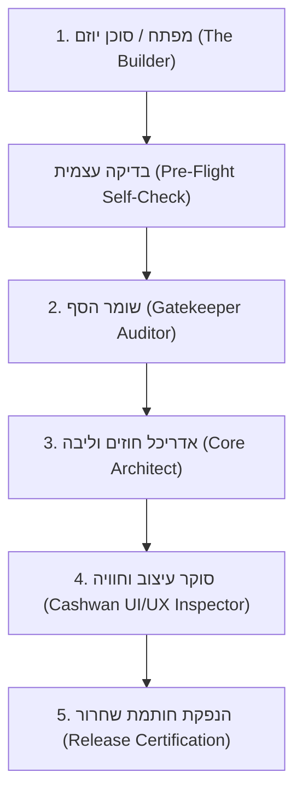
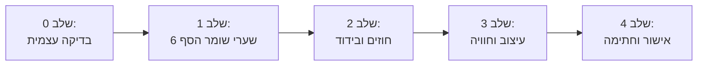

<div dir="rtl" style="text-align: right;">

# 🔍 פרוטוקול סקירה וביקורת מערכתית (Systemic Audit & Review Workflow) - KOSUN26

> 🏛️ **מסמך נוהל רשמי ומחייב**  
> מסמך זה מגדיר את מחזור החיים המלא של סקירת איכות, ביקורת ארכיטקטורה ואכיפת חוקי המערכת (Workflow) בכל שלב משלבי הפיתוח, השילוב והשחרור של רכיבי KOSUN26.

---

## 🎯 א. תכלית הפרוטוקול ומטרותיו

1. **אכיפה אחידה ובלתי מתפשרת:** הבטחה שכל רכיב, פיצ'ר, מסך או תיקון קוד עומד ב-100% מחוקי הארכיטקטורה, חוקת העיצוב ותקני האבטחה של KOSUN26.
2. **אפס רגרסיות מערכתיות:** מניעת מצב שבו שדרוג רכיב אחד שובר רכיבים שכנים או חודר לגבולות הגזרה שלהם (Zero Cross-Module Pollution).
3. **שמירה על פס ייצור עצמאי (Component a Day):** מתן מתודולוגיה ברורה ומהירה לביקורת, המאפשרת לקבל החלטות (Pass / Reject) בתוך דקות ספורות בצורה מבוססת כלים אוטומטיים ורשימות תיוג (Checklists).

---

## 👥 ב. תפקידים ותחומי אחריות במעגל הביקורת



| תפקיד במעגל הביקורת | תחום אחריות וסמכות | כלים ומנגנוני בדיקה |
| :--- | :--- | :--- |
| **המפתח / סוכן הייצור (Builder)** | הקמת הרכיב, שמירה על 10 השכבות, ובדיקה עצמית מקדימה טרם הגשה. | בדיקות מקומיות, תיעוד מלא, מניעת זיהום שורש. |
| **שומר הסף (Gatekeeper Auditor)** | אכיפה אוטומטית נוקשה של 6 שערי האיכות המערכתיים. | `npm run gatekeeper -- [module]` וכן `npm run gatekeeper` מערכתי. |
| **אדריכל החוזים (Core Architect)** | וידוא עקרון המונופול, מניעת יבוא ישיר בין מודולים, ובדיקת חוזי DTO בליבה. | ביקורת `src/core/contracts/`, בדיקת סקופ טננט ב-Firestore. |
| **מבקר העיצוב (Cashwan UI Inspector)** | אכיפת חוקת העיצוב המוחלטת, Floating Drawer, מודאלים 100%, RTL, וללא עומס. | בדיקת רפרנס מול `KOSUN26/עיצוב/showcase.html` וחוקי העיצוב. |

---

## 🚦 ג. 5 השלבים של זרימת העבודה (End-to-End Workflow)



### שלב 0: בדיקה עצמית מקדימה (Pre-Flight Self-Check)
לפני הגשת הרכיב לביקורת רשמית, הסוכן או המפתח מחויב לוודא:
* **היגיינת שורש:** שום קובץ זמני, סקריפט או קובץ בדיקה לא נשמר ב-`C:\comona\` אלא ב-`src/modules/[module]/scripts/`.
* **אנטומיית 10 השכבות:** כל 10 השכבות קיימות בדיוק:
  `types/`, `api/`, `services/`, `hooks/`, `context/`, `components/`, `views/`, `routes/`, `scripts/`, `index.ts`.
* אין תיקיית `prompts/` באף מודול מלבד `kosai-engine`.

---

### שלב 1: הרצה אוטומטית של 6 שערי שומר הסף (Gatekeeper Execution)
הרצה מחייבת של סקריפט שומר הסף בטרמינל:
```bash
# בדיקה ממוקדת לרכיב ספציפי
npm run gatekeeper -- [module-name]

# בדיקה מקיפה לכלל המערכת
npm run gatekeeper
```

#### תנאי סף למעבר:
1. **שער 1 (Root Hygiene):** 100% נקי מקבצים זרים.
2. **שער 2 (10-Layer Anatomy):** מבנה שכבות תקין ומלא.
3. **שער 3 (Monopoly & Direct AI Guard):** אפס קריאות ישירות ל-`generativelanguage.googleapis.com` (רק דרך Cloud Functions או `kosai-engine`), ואפס שרשראות פולבאק (Fallback Cascades).
4. **שער 4 (Multi-Tenant Scope):** אפס קריאות לאוספים שטוחים גלובליים (כגון `contacts` או `orders`) – שימוש בלעדי ב-`useTenantScope` ובנתיב המבודד:
   `tenants/{tenantId}/modules/{module}/{collection}`.
5. **שער 5 (Security Guard):** אפס מפתחות API, סיסמאות או טוקנים ב-`localStorage`/`sessionStorage`.
6. **שער 6 (Type Safety):** קומפילציית `tsc --noEmit` נקייה לחלוטין ללא שגיאות.

> ⛔ **כל שגיאה בשלב זה מהווה Block מיידי!** חל איסור מוחלט להמשיך לשלב הבא ללא פלט ירוק מלא (100% PASS).

---

### שלב 2: ביקורת ארכיטקטורה, חוזים ו-Slots (Contracts & Architecture Audit)
סוכן הביקורת סורק את קוד המקור של הרכיב ומוודא:
1. **אפס ייבוא הדדי (Zero Cross-Module Direct Imports):**
   * אין ייבוא מסוג `import { Something } from '../../other-module'`.
   * כל שיתוף נתונים מתבצע דרך `@/core/contracts`.
2. **שילוב ממשקים דרך תקע-שקע (Slot Architecture):**
   * כל צריכת ממשק חיצוני מתבצעת אך ורק באמצעות `<CapabilitySlot />`:
     ```tsx
     <CapabilitySlot 
       name="form-renderer" 
       props={{ formId: id }} 
       fallback={<FallbackCard title="רכיב טפסים" />} 
     />
     ```
   * רכיב שמספק ממשק רושם אותו ב-`index.ts` דרך `registerCapabilityUI`.
3. **עצמאות תפעולית (Standalone Graceful Degradation):**
   * אם יכולת חיצונית אינה זמינה, הרכיב מציג תצוגת Fallback עברית מכבדת ואינו קורס.

---

### שלב 3: ביקורת חוויית משתמש ושפת מותג קושאן (Cashwan UI/UX Inspection)
אימות התאמה מדויקת מול **חוקת העיצוב המוחלטת** ומול **`KOSUN26/עיצוב/showcase.html`**:

1. **חוק ה-Zero Header והביטול המוחלט של הסטריפ העליון:**
   * אין Header עליון סטטי, אין סטריפ אפור או מרווח ריק בראש המסך. התוכן מתחיל ב-`0px`.
   * ניווט ובקרה מנוהלים **אך ורק באמצעות תפריט צף (Floating Side Drawer)** שנפתח בלחיצה על אייקון צף.
   * **ברירת מחדל:** התפריט הצף מוסתר לחלוטין כברירת מחדל, ומכיל אייקון סגירה (`x`) בולט.
2. **חוק הזיהוי המינימליסטי:**
   * אין כותרות ענק או באנרים מסבירים בראש העמוד.
   * זיהוי בלעדי: אייקון קושאן וקטורי (`K`) + שם הרכיב באנגלית בלבד (למשל: `KOSUN CRM`, `KOSUN Forms`).
3. **מצב יום כברירת מחדל (Light Mode Standard):**
   * מצב יום הוא תמיד ברירת המחדל, בניגודיות מושלמת (High Contrast AAA - שחור עמוק על גבי רקע נקי).
   * אייקון מעבר למצב לילה ממוקם בפינה העליונה ככפתור צף דיסקרטי (`fixed top-4 left-4`).
4. **חוק ה-100% מסך מלא למודאלים (100% Fullscreen Modals):**
   * כל מודאל וחלון הגדרות נפרס על פני 100% משטח המסך (`fixed inset-0 w-screen h-screen`).
   * **מירכוז תוכן מוחלט:** התוכן ממורכז במדויק לאמצע המסך (הן אנכית והן אופקית).
   * בראש המודאל: אך ורק אייקון קושאן ושם הרכיב באנגלית + כפתור סגירה (`x`). אין באדג'ים וכותרות עמוסות.
5. **חוק הפריים-וורק לטפסים (Step-by-Step Forms):**
   * **שאלה אחת בלבד בכל שלב.**
   * כרטיסי בחירה מסודרים **תמיד שורה מתחת לשורה** (Vertical Stacking).
   * הקראה קולית עם עצירה ידנית בלבד (לעולם אין עצירה אוטומטית בעת שקט).
6. **עברית נקייה בגובה העיניים (Zero Technical Jargon):**
   * אפס מושגים טכניים למשתמש הקצה (אין מונחים כגון: "סנכרון", "REST API", "קולקציה", "אינטגרציה").
   * הסברים והרחבות מוצגים **אך ורק בטולטיפ מרחף**.
7. **איסור גלילה אופקית במובייל:**
   * אפס גלילה אופקית (`overflow-x: hidden`).
   * טבלאות מתפרקות במובייל לכרטיסים נערמים.

---

### שלב 4: נוהל תיקון ליקויים וריג'קטים (Remediation Protocol)
אם הביקורת מצאה ליקויים:

```mermaid
flowchart TD
    Finding["מציאת ליקוי (Finding)"] --> Classify{"סיווג חומרה"}
    Classify -->|חוסם (Blocker)| BlockerFix["עצירת מסירה מיידית + תיקון שורש"]
    Classify -->|בינוני (Major)| MajorFix["תיקון ארכיטקטוני ללא פשרות"]
    Classify -->|קל (Minor)| MinorFix["שיפור ניסוח / ריווח UI"]
    BlockerFix --> ReRun["הרצה חוזרת: npm run gatekeeper"]
    MajorFix --> ReRun
    MinorFix --> ReRun
    ReRun --> Verdict{"האם 100% ירוק?"}
    Verdict -->|לא| Finding
    Verdict -->|כן| Approval["מעבר לשלב החתימה והשחרור"]
```

* **ליקוי חוסם (Blocker):** קריאת AI ישירה מהלקוח, אוסף Firestore שטוח ללא טננט, שגיאת קומפילציה, או דליפת מפתח. הרכיב נפסל מיד.
* **תיקון יסודי:** תיקון הליקויים מתבצע ברמת השורש – חל איסור מוחלט לייצר פולבאק עוקף או מעקף זמני!
* **אימות חוזר (Re-Audit):** הרצה חוזרת של כל הבדיקות עד להשגת 100% הצלחה.

---

### שלב 5: חתימה, רישום ושחרור (Release Certification)
לאחר שכל השלבים עברו בהצלחה:
1. **רישום שער יצוא ב-`index.ts`:**
   * ייצוא ה-View הראשי.
   * רישום ספקי ה-UI דרך `registerCapabilityUI`.
2. **עדכון מפתח המערכת:**
   * הוספת הרכיב והתיעוד ב-`KOSUN26/מבוא_ומפתח_מערכת.md`.
3. **הנפקת דו"ח ביקורת סופי (Audit Sign-off):**
   * ציון תאריך, שם המודול, סטטוס 6 השערים, ותאימות עיצוב Cashwan מלאה.

---

## 📋 ד. צ'קליסט מעשי לבודק (Reviewer's Master Checklist)

| תחום בדיקה | קריטריון מחייב | סטטוס (V/X) |
| :--- | :--- | :---: |
| **היגיינה** | שורש הפרויקט נקי מכל קובץ סקריפט/בדיקה זמני | [ ] |
| **אנטומיה** | כל 10 השכבות קיימות בדיוק במודול ללא שכבות זרות | [ ] |
| **מונופול** | הרכיב אינו מממש מחדש פונקציונליות של מודול מוסמך אחר | [ ] |
| **קריאות AI** | אפס קריאות ישירות ל-Gemini; הכל דרך שרת / Cloud Functions | [ ] |
| **פולבאק** | אין שרשראות פולבאק עוקפות; שגיאות מוצגות למשתמש בעברית מכבדת | [ ] |
| **בידוד טננט** | שימוש בלעדי ב-`useTenantScope` ובנתיבי `tenants/{id}/modules/...` | [ ] |
| **אבטחה** | אפס שמירת טוקנים או מפתחות API ב-LocalStorage/SessionStorage | [ ] |
| **בטיחות טיפוסים** | `npx tsc --noEmit` עובר בהצלחה עם 0 שגיאות | [ ] |
| **חוזים** | אפס יבוא ישיר בין מודולים (`Zero Cross-Imports`); שימוש ב-Slots | [ ] |
| **Zero Header** | אין Header עליון סטטי, אין סטריפ עליון; התוכן מתחיל ב-0px | [ ] |
| **ניווט צף** | ניווט במגירה צפה בלבד, מוסתרת כברירת מחדל עם אייקון סגירה | [ ] |
| **זיהוי מותג** | אייקון קושאן + שם באנגלית בלבד; אין כותרות ובאנרים מסבירים | [ ] |
| **מצב תצוגה** | מצב יום (Light Mode) כברירת מחדל בניגודיות AAA מושלמת | [ ] |
| **מודאלים** | 100% מסך מלא, תוכן ממורכז במדויק לאמצע (אנכית ואופקית) | [ ] |
| **טפסים** | שאלה אחת בלבד בשלב, אפשרויות שורה מתחת שורה, הקראה קולית ידנית | [ ] |
| **שפה וטקסט** | שפה עברית טבעית בגובה העיניים, ללא שום מונחים טכניים | [ ] |
| **מובייל** | אפס גלילה אופקית; כרטיסים נערמים במקום טבלאות רחבות | [ ] |

---

## ⚡ ה. הרצה שוטפת ושילוב ב-CI/CD

לשמירה על רמת איכות מקסימלית:
* כל משימת פיתוח מסתיימת אך ורק כאשר פלט שומר הסף מחזיר:
  ```
  ✅ תקין - כל השערים עברו בהצלחה! 100% GREEN.
  ```
* סקריפט הביקורת המערכתי מנוהל ב-`scripts/gatekeeper.js` ומהווה את הבסיס האוטומטי לכל בדיקת קוד במערכת.

</div>
