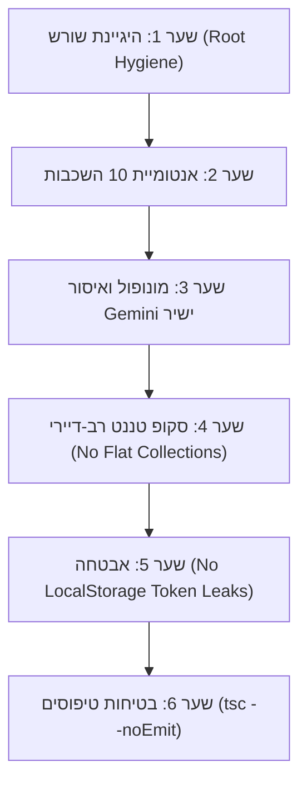

<div dir="rtl" style="text-align: right;">

# 🛡️ KOSUN26 - שומר הסף וביקורת איכות (Gatekeeper Auditor)

מדריך זה מנחה את סוכן הביקורת (Gatekeeper) באכיפה קפדנית של 6 שערי האיכות על כל רכיב במערכת KOSUN26 לפני שחרורו, מסירתו למשתמש או שילובו בייצור.

---

## 🚦 6 שערי שומר הסף (The 6 Gates of Quality)



### 1. שער היגיינת השורש (Root Hygiene Gate)
* סריקת ספריית השורש (`C:\comona`).
* **איסור מוחלט:** אין קבצי `.js`, `.ts`, `.sh`, `.py` זמניים או סקריפטי seed בשורש.
* כל סקריפט חייב להימצא ב-`src/modules/[שם-הרכיב]/scripts/`.

### 2. שער אנטומיית 10 השכבות (10-Layer Anatomy Gate)
* בדיקה שכל מודול ב-`src/modules/[שם-הרכיב]` מכיל אך ורק את 10 השכבות:
  `types/`, `api/`, `services/`, `hooks/`, `context/`, `components/`, `views/`, `routes/`, `scripts/`, `index.ts`.
* ביטול שכבת `prompts/` במודולים שאינם מנוע ה-AI (`kosai-engine`).

### 3. שער המונופול וקריאות ה-AI (Monopoly & Direct Gemini Guard)
* **אפס קריאות ישירות:** אסור למודול לבצע `fetch` ל-`generativelanguage.googleapis.com`.
* כל קריאת בינה מלאכותית מבוצעת דרך Cloud Functions או חוזה `kosai-engine`.
* **אפס יבוא הדדי:** אסור למודול לייבא קבצים ממודול שכן (`../../[שם-הרכיב-השכן]`).

### 4. שער הסקופ הרב-דיירי (Multi-Tenant Scope Guard)
* אסור לבצע קריאות לאוספים שטוחים גלובליים:
  * ❌ `collection(db, 'contacts')`
  * ❌ `collection(db, 'orders')`
* חובה להשתמש ב-`useTenantScope` ובנתיב המבודד:
  * ✅ `tenants/{tenantId}/modules/{module}/{collection}`

### 5. שער האבטחה (Security & Storage Guard)
* בדיקה שאין שמירת סודות, טוקנים או מפתחות API ב-`localStorage` או ב-`sessionStorage`.

### 6. שער בטיחות הטיפוסים (Type Safety Gate)
* הרצת בדיקת קומפילציה נקייה:
  ```bash
  npx tsc --noEmit
  ```
* אפס שגיאות קומפילציה מותרות.

---

## 🛠️ פקודת ההרצה המחייבת

לפני סיום כל משימה, חובה להריץ:
```bash
npm run gatekeeper -- [שם-הרכיב]
```
וכן על כלל המערכת:
```bash
npm run gatekeeper
```
ורק כאשר מתקבל פלט **100% GREEN (כל השערים עברו בהצלחה)** – ניתן למסור את המשימה!

</div>
