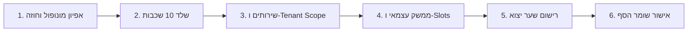

<div dir="rtl" style="text-align: right;">

# 🏭 KOSUN26 - פס ייצור מודולרי ועבודת צוות

מדריך זה מנחה את סוכני ה-AI והמפתחים בעבודה סדורה של פס ייצור סדרתי לפיתוח רכיבים עצמאיים ומבודדים במערכת KOSUN26 בקצב של לפחות **רכיב אחד ביום**, תוך שמירה על בידוד מוחלט ואפס רגרסיות.

---

## 👥 חלוקת תפקידים בצוות הפיתוח

1. **אדריכל החוזים והסכמות (Contract & Data Architect):**
   * מגדיר את גבולות הגזרה של הרכיב ואת המונופול הבלעדי שלו.
   * קובע את ה-DTOs והממשקים בקובץ הליבה המרכזי `src/core/contracts/index.ts`.
   * מוודא מניעת חפיפה עם מונופולים קיימים (`auth-portal`, `kosai-engine`, `brand-dna-hub` וכו').
2. **מהנדס התשתיות והשירותים (Backend & Services Engineer):**
   * מקים את תיקיית המודול עם 10 השכבות האנטומיות המדויקות.
   * מממש שירותי Firestore מבודדי טננט מלאים באמצעות `useTenantScope`.
   * מוודא שאף קריאה אינה פונה ישירות ל-Gemini או לאוסף גלובלי שטוח.
3. **בונה הממשק וה-Slots (UI & Slot Composer):**
   * בונה קומפוננטות ממשק לפי שפת העיצוב Cashwan Branding (מעגן צף Floating Dock, מודאלים 100% מסך מלא, כיווניות RTL מלאה).
   * צורך יכולות חיצוניות אך ורק דרך רכיב השקע הגלובלי `<CapabilitySlot />`.
   * מייצא רק את ה-Root View ורושם ספקי יכולות ב-`index.ts`.
4. **שומר הסף (Gatekeeper Auditor):**
   * מריץ את בדיקות 6 השערים האוטומטיים (`npm run gatekeeper`).
   * מוודא 100% תקינות שלמות, היגיינה, אבטחה וקומפילציה נקייה.

---

## 🔄 שלבי פס הייצור (Step-by-Step Assembly Protocol)



### שלב 1: אפיון מונופול וחוזה בליבה (Core Contracts)
* האם הרכיב מייצר נתונים שרכיבים אחרים יצטרכו לצרוך?
  * אם כן: נגדיר ממשק ו-DTO ב-`src/core/contracts/index.ts`.
* האם הרכיב זקוק לתצוגה מרכיב אחר (כגון טופס, גלריה או עוזר AI)?
  * אם כן: נשתמש ב-Slot המתאים מתוך הליבה.

### שלב 2: הקמת שלד 10 השכבות
הקמת התיקייה ב-`src/modules/[שם-הרכיב]/`:
```
src/modules/[שם-הרכיב]/
├── types/
├── api/
├── services/
├── hooks/
├── context/
├── components/
├── views/
├── routes/
├── scripts/
└── index.ts
```

### שלב 3: מימוש לוגיקת נתונים מבודדת טננט
* שימוש בלעדי ב-`useTenantScope` לנתיבי Firebase.
* מניעת קריאות AI מקומיות – שימוש בקריאות Cloud Functions ייעודיות בלבד.

### שלב 4: פיתוח ה-UI וחיבור ה-Slots
* כל נקודת חיבור לרכיב אחר ממומשת כ-Slot:
  ```tsx
  <CapabilitySlot 
    name="form-renderer"
    props={{ formId: item.formId }}
    fallback={<FallbackCard title="טופס מוטמע" />}
  />
  ```

### שלב 5: רישום ושער יצוא (`index.ts`)
* יצוא ה-View הראשי בלבד.
* אם המודול הוא ספק יכולת (Provider) – רישום ב-`registerCapabilityUI`.

### שלב 6: חותמת שומר הסף (Gatekeeper Verification)
* הרצת `npm run gatekeeper -- [שם-הרכיב]`.
* כל 6 השערים חייבים להיות ירוקים ללא פשרות.

</div>
