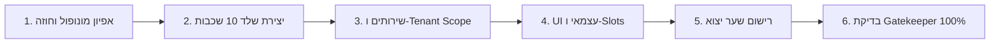

# 🏭 KOSUN26 Modular Factory & Teamwork Workflow

<div dir="rtl" style="text-align: right;">

סקיל זה מנחה את סוכני ה-AI והמפתחים בעבודה סדורה של פס ייצור (Assembly Line) להקמת רכיב חדש או שדרוג רכיב קיים במערכת KOSUN26, בקצב של לפחות רכיב אחד ביום, בבידוד מלא ובאפס רגרסיות.

---

## 👥 חלוקת תפקידים בעבודת צוות (Teamwork Roles)

1. **אדריכל החוזים והסכמות (Contract & Data Architect):**
   * מוודא את המונופול של הרכיב (איזה תחום הוא מנהל בלעדית).
   * מגדיר את ה-DTOs והממשקים ב-`src/core/contracts/index.ts`.
   * מוודא שאין חפיפה עם מונופולים קיימים (`auth-portal`, `kosai-engine`, `brand-dna-hub` וכו').
2. **בונה התשתית והשירותים (Backend & Services Engineer):**
   * מקים את תיקיית המודול עם 10 השכבות המדויקות.
   * מממש שירותים מבוססי `useTenantScope` ב-Firestore.
   * מבטיח אפס קריאות ישירות ל-Gemini או אוספים שטוחים.
3. **בונה ממשק המשתמש וה-Slots (UI & Slot Composer):**
   * מקים קומפוננטות UI העומדות בתקן Cashwan Branding (Floating Dock, Fullscreen Modal, ללא Header עליון).
   * משלב יכולות חיצוניות אך ורק דרך `<CapabilitySlot />`.
   * מייצא רק את ה-Root View ורושם ספקי יכולות ב-`index.ts`.
4. **שומר הסף (The Gatekeeper Auditor):**
   * מריץ בדיקות קומפילציה, היגיינה, אבטחה וסריקת תלויות.
   * מאשר סופית את העברת הרכיב לשימוש.

---

## 🔄 שלבי פס הייצור (Step-by-Step Assembly Protocol)



### שלב 1: אפיון מונופול וחוזה (Core Contracts)
* האם הרכיב מייצר נתונים שרכיבים אחרים יצטרכו?
  * אם כן: הוסף ממשק ב-`src/core/contracts/`.
* האם הרכיב זקוק ל-UI מרכיב אחר (כגון טופס, גלריה או AI)?
  * אם כן: בדוק את שם ה-Capability Slot הרלוונטי.

### שלב 2: הקמת שלד 10 השכבות
הקמת התיקייה ב-`src/modules/[module-name]/`:
```
src/modules/[module-name]/
├── types/
├── api/
├── services/
├── hooks/
├── context/
├── components/
├── views/
├── routes/
├── scripts/
└── index.ts
```

### שלב 3: מימוש לוגיקת נתונים מבודדת טננט
* שימוש בלעדי ב-`useTenantScope` לנתיבי Firebase.
* מניעת קריאות AI מקומיות – שימוש בקריאות Cloud Functions ייעודיות בלבד.

### שלב 4: פיתוח ה-UI וחיבור ה-Slots
* כל נקודת חיבור לרכיב אחר ממומשת כ-Slot:
  ```tsx
  <CapabilitySlot 
    name="form-renderer"
    props={{ formId: item.formId }}
    fallback={<FallbackCard title="טופס מוטמע" />}
  />
  ```

### שלב 5: רישום ושער יצוא (`index.ts`)
* יצוא ה-View הראשי בלבד.
* אם המודול הוא ספק יכולת (Provider) – רישום ב-`registerCapabilityUI`.

### שלב 6: חותמת שומר הסף (Gatekeeper Verification)
* הרצת `npm run gatekeeper -- [module-name]`.
* כל 6 השערים חייבים להיות ירוקים ללא פשרות.

</div>
