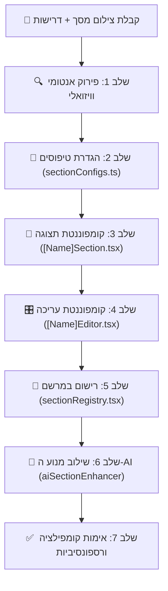

<div dir="rtl" style="text-align: right;">

# 🧩 יוצר האזורים - KOSWEBBUILDER (Section Creator Skill)

סקיל זה מגדיר את תהליך העבודה הסטנדרטי, המהיר והמדויק לפיתוח אזור (Section) חדש ברכיב **KOSWEBBUILDER** (`KosWebAi`), החל מצילום מסך של עיצוב מבוקש ועד לקומפוננטה עצמאית, מודולרית, תומכת עריכה חיה ושילוב מלא ב-AI.

---

## 🎯 מטרת הסקיל
קבלת עיצוב חזותי (צילום מסך / Mockup) והמרתו לרכיב עצמאי מושלם לפי חוקת **KOSUN26**:
1. **נראות (Presentation):** קומפוננטת תצוגה עשירה, מותאמת ב-100% ל-RTL, פונט Heebo בלעדי, רספונסיבית מלאה (מובייל/דסקטופ), ותמיכה ב-Light/Dark Mode.
2. **עריכה (Editor):** פאנל עריכה ייעודי המאפשר למשתמש לשלוט בכל פרמטר ויזואלי ותוכני בזמן אמת.
3. **עיצוב ושדרוג ב-AI:** הגדרת סכמה ופרומפטים המאפשרים למנוע ה-AI של הרכיב לחולל, לשכתב ולשדרג את תוכן האזור באופן אוטונומי.
4. **עצמאות מוחלטת:** כל אזור נשמר כתיקייה/קומפוננטה עצמאית ללא תלות ישירה ברכיבים שכנים.

---

## 📋 שלבי תהליך העבודה (Step-by-Step Protocol)



---

### שלב 1: פירוק אנטומי וויזואלי (Visual Deconstruction)
בעת קבלת צילום המסך והדרישות מהמשתמש, יש לנתח:
1. **מבנה הגריד והפריסה (Layout):**
   - האם הפריסה היא Bento Grid, עמודות, רשימה נערמת (Stacked), קרוסלה, או כרטיסים צפים?
   - התנהגות במובייל: איך האלמנטים נערמים בעמודה יחידה (`flex-col` / `grid-cols-1 md:grid-cols-3`).
2. **רכיבי התוכן (Content Elements):**
   - כותרת עליונה (Badge / Subtitle / Pre-title).
   - כותרת ראשית (Title) ופסקת הסבר (Description).
   - פריטי תוכן חוזרים (Items / Cards / Badges / Metrics / Bullets).
   - כפתורי הנעה לפעולה (CTAs / Primary & Secondary Buttons).
   - מדיה: תמונה ראשית, גלריה, אייקונים (Lucide React), או וידאו.
3. **סגנון חזותי (Visual Styling & Tokens):**
   - רקעים (Mesh Glow, Glassmorphism, סולידי, גרדיאנט, גבולות עדינים).
   - הדגשות טיפוגרפיות (צבעי מותג, ניגודיות WCAG AAA).

---

### שלב 2: הגדרת הטיפוסים (`src/modules/KosWebAi/types/sectionConfigs.ts`)
הגדרת ממשק TypeScript קפדני עבור קונפיגורציית האזור.
* **חובה לרשת או לכלול מאפייני בסיס:** `id`, `anchorId`, `backgroundColor`, `titleColor`, `descriptionColor`.
* **טיפוס מדויק לכל שדה:** ללא שימוש ב-`any`.
* **עדכון איחוד הטיפוסים ב-`pageBuilder.types.ts`:**
  - הוספת מזהה האזור ל-`SectionType` (לדוגמה `'mySpecialBento'`).
  - הוספת הקונפיגורציה ל-`PageSection['config']`.

```typescript
// לדוגמה:
export interface MySectionItem {
  id: string;
  title: string;
  description: string;
  iconName?: string;
  tag?: string;
}

export interface MySectionConfig {
  anchorId?: string;
  badge?: string;
  title: string;
  subtitle?: string;
  description?: string;
  items: MySectionItem[];
  primaryButton?: { text: string; url: string; variant?: 'solid' | 'outline' };
  backgroundColor?: string;
  cardStyle?: 'glass' | 'solid' | 'bordered';
  columns?: 2 | 3 | 4;
}
```

---

### שלב 3: בניית קומפוננטת התצוגה העצמאית (`sections/[name]/[Name]Section.tsx`)
קומפוננטה עצמאית לחלוטין המקבלת `{ config: MySectionConfig }`:
* **חוקי KOSUN26 המחייבים:**
  - **כיווניות:** תמיכה מלאה ובלעדית ב-RTL (`dir="rtl"`).
  - **טיפוגרפיה:** שימוש בפונט Heebo בלבד (`font-sans` עם Tailwind המוגדר ל-Heebo).
  - **רספונסיביות:** אפס גלילה אופקית במובייל. מרווחים מותאמים (`py-12 md:py-20 px-4 sm:px-6 lg:px-8`).
  - **Light / Dark Mode:** שימוש במחלקות כפולות (לדוגמה `text-slate-900 dark:text-white`, `bg-white/80 dark:bg-slate-900/80`).
  - **שקע-תקע בלבד:** אם נדרש טופס או נגן וידאו מודולרי, צורכים אותו דרך `<CapabilitySlot />`.

---

### שלב 4: בניית קומפוננטת העריכה (`sections/[name]/[Name]Editor.tsx`)
רכיב העורך המוצג בסרגל הצד / במודאל העריכה:
* מקבל `{ config: MySectionConfig, onUpdate: (newConfig: Partial<MySectionConfig>) => void }`.
* מאפשר עריכה ויזואלית נוחה באמצעות רכיבי ה-UI המשותפים של הרכיב:
  - `PageBuilderInput` / `PageBuilderTextarea` לטקסטים וכותרות.
  - `PageBuilderColorPicker` לבחירת צבעי רקע וטקסט.
  - `PageBuilderAccordion` לחלוקה נוחה של מקטעי עריכה (תוכן ראשי, פריטים, עיצוב וצבעים).
  - הוספה, עריכה, סידור מחדש ומחיקה של פריטים דינמיים (`items`).

---

### שלב 5: רישום במרשם המרכזי (`src/modules/KosWebAi/registry/sectionRegistry.tsx`)
הוספת האזור החדש ל-`SECTION_REGISTRY`:
1. ייבוא קומפוננטת התצוגה והעורך.
2. הגדרת כרטיס המטא-דאטה:
   - `type`: מזהה ייחודי.
   - `label`: שם ברור בעברית (למשל "גריד יתרונות פרימיום").
   - `description`: הסבר קצר על מטרת האזור.
   - `category`: קטגוריה (hero, content, commerce, engagement, media וכו').
   - `icon`: אייקון מתאים מ-`lucide-react`.
   - `defaultConfig`: מבנה נתונים מלא כברירת מחדל בעברית רהוטה ואיכותית.
   - חיבור ה-`component` וה-`editor`.

---

### שלב 6: שילוב במנוע ה-AI (AI Generation & Enhancement)
כדי שה-AI יידע לייצר ולשדרג את האזור:
1. הוספת האזור ל-`generators/pageGenerator.ts` במידת הצורך (פרומפט מובנה ליצירת עמודים שלמים).
2. הוספת תמיכה ב-`generators/sectionEnhancerService.ts` לשדרוג תכנים, שכתוב שיווקי, והתאמת טקסטים לקהל יעד.

---

### שלב 7: בדיקת איכות ושומר סף (Gatekeeper Verification)
1. **בדיקת קומפילציה:** בדיקה שאין שגיאות TypeScript או ייבוא חסר.
2. **אימות מובייל:** וידוא שהגריד נשבר היטב לטור יחיד במסכים קטנים ללא חיתוכי טקסט.
3. **היגיינת ייבוא:** אפס ייבוא הדדי ממודולים אחרים במערכת (Zero Cross-Module Imports).

</div>
